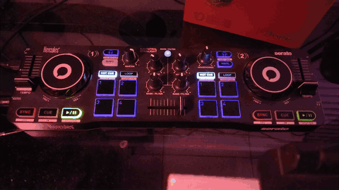

# starlight-hack

**Usa tu Hercules DJControl Starlight para mucho más que mezclar.** Sus botones, perillas y pads pueden manejar tu computador, las luces de tu casa y tus sesiones de Claude Code. Su luz de colores te avisa lo que pasa.

<p align="center">
  
  <br>
  <sub>El show de <a href="scripts/show.py"><code>scripts/show.py</code></a>. Al final, la Starlight avisa que Claude Code hizo una pregunta: titilan los pads de las opciones y respondes con uno.</sub>
</p>

Proyecto independiente, sin relación con Hercules. Probado en Windows 11 con la versión 1.0.0.0 del aparato. Tiene código para macOS y Linux, pero aún no lo hemos probado ahí.

## Qué puedes hacer

- **Manejar el computador.** Cada control hace lo que elijas: un atajo de teclado, pausar la música, el volumen de Windows o de una app, desplazarte, abrir un programa.
- **Pilotear tus sesiones de Claude Code.** La base respira en el color de Claude, más rápido mientras más sesiones trabajan, y titila cuando una te necesita. Los 8 pads muestran tus sesiones; uno te lleva a su terminal en Wave, y ahí los pads muestran sus opciones, con la recomendada titilando. Cada luz prendida es algo que puedes hacer.
- **Prender las luces de tu casa.** Philips Hue y Home Assistant, con un botón o una perilla.
- **Pintar la luz de la base.** La base son las dos luces de colores que el aparato tiene debajo. Puedes usar 12 colores o cualquier otro, fijos, parpadeando o respirando.
- **Programarla a tu gusto.** Trae un servidor con una API (una forma de darle órdenes por HTTP desde cualquier programa), una CLI (los comandos `starlight …` de la terminal) y perfiles en Python.

## Empieza en 5 minutos

Necesitas:

- Una Hercules DJControl Starlight conectada por USB. No necesitas instalar drivers: mira [Drivers y dependencias](#drivers-y-dependencias).
- Python 3.10 o más reciente, y Git.

**1. Descarga e instala.** En la terminal:

```powershell
git clone https://github.com/oddradiocircle/starlight-hack.git
cd starlight-hack
python -m venv .venv
.venv\Scripts\pip install -e .
```

En macOS o Linux, cambia la última línea por `.venv/bin/pip install -e .`.

**2. Arranca el servidor.**

```powershell
.venv\Scripts\starlight serve --abrir
```

Se abre el tablero en tu navegador, en `http://127.0.0.1:8765`.

**3. Toca un control de la Starlight.** El dibujo del tablero se mueve contigo y abajo ves qué control fue y su mensaje.

**4. Mira el show.** En otra terminal, dentro de la carpeta, corre `.venv\Scripts\python scripts\show.py` (en macOS o Linux: `.venv/bin/python scripts/show.py`). Cuando Play A titile, presiónalo: es el show del video de arriba. Al terminar, todo vuelve a quedar como estaba.

Para no escribir `.venv\Scripts\` cada vez, activa el entorno con `.venv\Scripts\activate` (en macOS o Linux: `source .venv/bin/activate`).

### Si algo falla

| Si pasa esto | Haz esto |
|---|---|
| El tablero dice «Desconectada» | Revisa el cable USB. Luego corre `starlight estado`. |
| La Starlight dejó de responder | Detén el servidor con Ctrl + C y arráncalo otra vez. Si sigue igual, desconecta y conecta el USB. |
| `pip` falla con un error de certificados | Tu antivirus revisa las conexiones seguras (pasa con Avast). Define la variable `PIP_USE_FEATURE=truststore` y repite. |
| El volumen subió muchísimo | Activaste el modo computador. Baja el volumen y desconecta y conecta el USB. |

## Úsala

### El tablero

<picture>
  <source media="(prefers-color-scheme: dark)" srcset="docs/img/tablero-oscuro.png">
  
</picture>

Es la página que abre el servidor. Muestra la Starlight en vivo y te deja:

- prender o hacer titilar la luz de cada botón y pad;
- pintar la base y elegir su efecto, su brillo y su velocidad;
- cambiar el modo de los pads (Hot Cue, Loop, FX, Sampler);
- ver tus sesiones de Claude Code.

También funciona en el celular. Mira [Desde otro equipo](#desde-otro-equipo-o-el-celular).

### Perfiles

Un perfil dice qué hace cada control en el computador. Vienen cinco:

| Perfil | Qué hace |
|---|---|
| Claude Code | Play A envía, Cue A interrumpe, Sync A cambia de modo y los pads A responden 1, 2 y 3. La base muestra el estado de tus sesiones. |
| Escritorio | Play pausa la música. Cue y Sync pasan a la canción anterior o a la siguiente. Volume A es el volumen de Windows. |
| Luces | La base sigue el ritmo de lo que suena en el computador. |
| Mezclador | Volume A es el volumen de Spotify y Volume B el de Chrome. El crossfader reparte entre los dos y PFL silencia cada uno. La base muestra el volumen: verde para Spotify, azul para Chrome. Al salir del perfil, cada app vuelve a su volumen. Para usar otras apps, cambia `APPS` en `starlight/perfiles_incluidos/mezclador.py`. |
| Navegar | Jog A desplaza arriba y abajo, Jog B a los lados. Shift + Jog A hace zoom. |

Para cambiar de perfil:

- **En el aparato:** Shift + Vinyl pasa al siguiente. Shift + Bass/Filter vuelve al anterior.
- **En el tablero:** elígelo arriba, junto a «Perfil».
- **En la terminal:** `starlight perfil <nombre>`.

El servidor recuerda el último perfil que usaste.

### Edita un perfil


1. En el tablero, abre **Editar perfiles**.
2. Elige un control: tócalo en el dibujo, o presiona «Elegir tocando la Starlight» y tócalo en el aparato.
3. Debajo aparece lo que hace. Cámbialo y presiona **Guardar**.

Puedes asignar:

- **Acciones:** un atajo de teclado (lo grabas presionándolo), una tecla multimedia, escribir un texto, abrir un programa o una página, el volumen de Windows o de una app, desplazarte, flechas, zoom, el color de la base, cambiar de perfil o las luces de la casa.
- **Cuándo:** al presionar o al soltar, con Shift o sin Shift.
- **Solo si:** según el programa que tengas al frente o el estado de Claude Code. Ejemplo: Play A envía Enter solo si la terminal está al frente.
- **Escena:** deja el aparato como lo quieres y presiona «Grabar en el perfil». Al activar el perfil, la base, las luces y los modos de los pads vuelven a quedar así.

Para compartir un perfil, presiona **Exportar**. Se descarga un archivo `.starlight.json`. Quien lo reciba lo abre con **Importar…** y lo revisa antes de guardarlo.

Los perfiles incluidos no se borran. Si cambias uno, se guarda tu copia en `~/.starlight/perfiles` (en Windows, `C:\Users\<tu usuario>\.starlight\perfiles`).

### Claude Code en la Starlight


El perfil **Claude Code** convierte la Starlight en el tablero de tus sesiones. Sigue un principio: **cada luz dice algo**. Fija = presionar sirve ahora. Titila = te necesita, o es lo que Claude recomienda. Apagada = ahora no hace nada.

**La base**, en el color de Claude, dice cuánto está pasando:

| La base | Qué significa |
|---|---|
| Respira | Claude trabaja. Respira más rápido mientras más sesiones trabajen: cada 4 s con una, 3 s con dos, 2,2 s con tres y 1,6 s con cuatro o más. |
| Titila | Una sesión te necesita: pide permiso, te hace una pregunta o quiere que apruebes un plan. Titila más rápido si son varias. |
| Fija y brillante | Estás respondiendo desde los pads. |
| Fija, a media luz | Terminó y espera tu siguiente mensaje. |
| Fija y tenue | La sesión lleva un rato sin que le escribas. |
| Titila muy rápido | Una respuesta falló. |

Con varias sesiones, la base muestra la más urgente. El color, la intensidad y el ritmo se cambian en el editor. El ritmo puede ser una lista, uno por cantidad de sesiones. El color es `#ff1100`, afinado mirando el aparato. Probamos antes el color de Claude (`#D97757`, pasado a luz lineal: `#ff4423`), pero su verde y su azul hacen que el LED se vea blanquecino. Las intensidades son 100 % (trabajando, te necesita, respondiendo y error), 71 % (terminó), 50 % (inactiva) y 36 % (sin sesiones). Solo esas conservan el tono exacto: el LED tiene 128 pasos por canal, y a otras intensidades el verde se redondea distinto y el color cambia.

**Los 8 pads tienen dos vistas, y el modo de pads dice en cuál estás.** El aparato solo muestra las luces del modo activo.

- **Sesiones (Hot Cue).** Un pad por sesión, siempre el mismo. La velocidad del titileo dice la urgencia:

  | El pad | Qué significa |
  |---|---|
  | Titila rápido | Te necesita ya: una pregunta, un permiso o un error |
  | Titila lento | Terminó su turno y espera tu mensaje, y no has ido a verla |
  | Fijo | Abierta: trabajando, o terminada que ya viste |
  | Apagado | No hay sesión |

  «Ir a verla» cuenta igual con su pad, con PFL B, con el mouse o con el teclado: mientras haya sesiones terminadas sin ver, el servidor mira cada segundo qué terminal tiene el foco en Wave. Al tocar un pad, Wave te lleva a su terminal. Si te necesita, los pads pasan a Responder.
- **Responder (Loop).** Lo que esa sesión tiene en pantalla. Si es una pregunta, hay un pad por opción y titila la que Claude recomienda. Si es un permiso: Sí en el pad 1, «Sí, no volver a preguntar» en el 2 y No en el 8, lejos del Sí. Ninguna opción de permiso titila: el control no te empuja a aprobar. Tocar una opción responde y vuelve a Sesiones. Si respondes con el teclado o cancelas, también vuelve sola.

Presionar Hot Cue o Loop en el aparato también cambia de vista.

**Los botones se prenden solo cuando sirven:**

| Botón | Se prende | Al presionar |
|---|---|---|
| Play B | Titila si alguna sesión te necesita | Te lleva a la que más lleva esperando |
| PFL B | Fijo si alguna terminó y no la has visto | Te lleva a la última que terminó |
| Cue A y Cue B | Fijo si algo trabaja o si estás respondiendo | Esc (Shift + Cue A: Ctrl+C) |
| Sync A | Fijo si hay sesiones | Shift+Tab: cambia el modo de Claude |
| Play A | Fijo si hay que confirmar | Enter |

Los botones y los pads titilan a su propio ritmo, aparte de la base: un ciclo cada 0,8 s el rápido y cada 2 s el lento. Se cambian con las claves `"titileo"` y `"titileo_lento"` del perfil (segundos), o en vivo con `starlight ritmo botones 0.5` y `starlight ritmo botones_lento 3`.

Las teclas van a la ventana que tienes al frente. En Responder van a la sesión que estás respondiendo, porque es la única que el control conoce con certeza: si cambias de sesión con el mouse, el control no se entera.

En el editor, estas son las acciones «Claude: sesión u opción», «Claude: ir a una sesión» y «Claude: tecla». Úsalas en tus propios perfiles.

**Límites conocidos (2026-11-11):**
- Si Claude hace varias preguntas a la vez, o una de selección múltiple, los pads muestran solo la primera pregunta.
- Para aprobar un plan, el control supone 3 opciones; falta confirmarlo en cada versión de Claude Code.
- Ir a una sesión funciona solo en Windows, hasta la pestaña 9 y el bloque 9 de cada pestaña (los atajos de Wave llegan hasta 9).

**Para conectarla, agrega los hooks a Claude Code.** Un hook es un comando que Claude Code corre en cada evento. Estos le avisan al servidor:

1. Abre `~/.claude/settings.json` (en Windows, `C:\Users\<tu usuario>\.claude\settings.json`).
2. Copia ahí la clave `"hooks"` de [`scripts/hooks-claude-code.json`](scripts/hooks-claude-code.json). Si ya tienes hooks, agrega cada evento a tu lista.
3. Abre una sesión nueva de Claude Code y comprueba con `starlight claude sesiones`.

Los hooks usan `curl`, que ya viene en Windows 10 y 11, macOS y Linux. Corren en segundo plano y nunca fallan, aunque el servidor esté apagado. De cada evento, el servidor solo lee la sesión, el tipo de evento, la herramienta, la carpeta, el aviso y el texto de las preguntas. No guarda nada en disco.

**Para que los pads te lleven a cada sesión: Wave Terminal.** Ir a una sesión usa [Wave](https://www.waveterm.dev/), aunque la sesión esté en otra pestaña. El servidor trae Wave al frente, cambia de pestaña con **Alt + número** y enfoca la terminal con **Ctrl + Shift + número**: son atajos de Wave. Para saber qué número tiene cada pestaña y cada terminal, lee la base de datos de Wave (`waveterm.db`) en solo lectura, y la vuelve a leer para confirmar que el foco quedó en la terminal correcta. Una respuesta solo se escribe si Wave lo confirmó; si no, la página dice por qué.

Agrega [`scripts/wave_hook.sh`](scripts/wave_hook.sh) como un segundo hook en los mismos eventos. Pinta de naranja el borde de la terminal que te necesita y le pone una insignia verde cuando termina. Además, le dice al servidor en qué bloque de Wave corre cada sesión:

```json
{ "type": "command", "async": true, "timeout": 10,
  "command": "bash \"/ruta/a/starlight-hack/scripts/wave_hook.sh\" esperando" }
```

Usa `esperando` en PreToolUse y en Notification (permission_prompt y elicitation_dialog), `trabajando` en UserPromptSubmit, PostToolUse y SessionEnd, y `listo` en Stop. El servidor guarda los bloques en `~/.starlight/claude-bloques.json`, así que un reinicio no los olvida.

Sin Wave, los pads igual muestran tus sesiones y responden, pero en la ventana que esté al frente.

**Cancelar con Esc.** Cuando cancelas una pregunta o un permiso con Esc, Claude Code no avisa a ningún hook: el evento de fin (Stop) no corre si interrumpes. [`scripts/vigilante.sh`](scripts/vigilante.sh) lo resuelve: mientras una sesión te espera, mira su historial, y apenas respondes o cancelas, quita el naranja de Wave y le avisa al servidor. `wave_hook.sh` lo arranca solo. Si no usas Wave, agrégalo como hook en los eventos que esperan (PreToolUse de AskUserQuestion y ExitPlanMode, y Notification de permission_prompt y elicitation_dialog): `bash "/ruta/a/starlight-hack/scripts/vigilante.sh"`.

**Claude Code en WSL.** Los mismos hooks funcionan en el `~/.claude/settings.json` de Linux, con la ruta de Windows vista desde WSL, por ejemplo `bash /mnt/c/Users/<tu usuario>/starlight-hack/scripts/wave_hook.sh esperando`. WSL tiene que llegar a `127.0.0.1:8765`. Con `networkingMode=mirrored` en `%UserProfile%\.wslconfig` llega directo.

### Las luces de tu casa


En el tablero, abre **Casa**:

- **Home Assistant:** presiona «Buscar en mi red». Luego pega un token de acceso de larga duración. Lo creas en tu perfil de Home Assistant, en «Seguridad».
- **Philips Hue:** presiona «Buscar en mi red». Luego presiona el botón redondo del puente y, antes de 30 segundos, «Emparejar».

Después, en un perfil, la acción **«Luces de la casa»** prende, apaga o cambia el color de una luz, o activa una escena. Con una perilla mueves el brillo.

Todo pasa dentro de tu red. La conexión se guarda solo en tu equipo, en `~/.starlight/casa.json`, y la página nunca vuelve a mostrar el token. Si Hue Sync está sincronizando un área, esas luces no responden hasta que la pauses.

### Desde la terminal

```bash
starlight escuchar                      # muestra en vivo cada control que tocas
starlight base rojo --efecto respira    # color de la paleta (1 a 12, o su nombre)
starlight base "#ff0080" --lado izq     # cualquier color
starlight base auto                     # la base vuelve a su show normal
starlight brillo 40                     # brillo de la base, de 0 a 100
starlight ritmo botones 0.5             # segundos por titileo de botones y pads (también: botones_lento, parpadeo, respira)
starlight luz A.play on                 # luces: A.play, B.cue, vinyl, bassfilter, A.pad1…
starlight modo A fx                     # modo de los pads: hotcue, loop, fx, sampler
starlight perfil navegar                # cambia de perfil
starlight midi 91 07 7F                 # un mensaje MIDI a mano
starlight estado                        # todo lo que sabe el servidor
```

MIDI es el idioma en que la Starlight y el computador se hablan. Cada mensaje son 3 números en hexadecimal: `91 07 7F` prende la luz de Play A.

### Desde tus programas

El servidor es el único que habla con el aparato. Tus scripts le hablan por HTTP, en `http://127.0.0.1:8765`. Ejemplo con `curl`:

```bash
curl -X POST http://127.0.0.1:8765/api/base -H "Content-Type: application/json" -d '{"color": "verde", "efecto": "respira"}'
```

<details>
<summary>Todas las rutas de la API</summary>

| Método | Ruta | Cuerpo | Qué hace |
|---|---|---|---|
| GET | `/api/estado` | | Conexión, posiciones, luces, base y modos |
| GET | `/api/controles` | | Lista de controles, luces, modos, efectos y paleta |
| GET | `/api/eventos` | | Flujo en vivo (SSE): `control`, `luz`, `base`, `modo`, `conexion` |
| POST | `/api/luz` | `{"control": "A.play", "encendida": true}` | Prende o apaga una luz; los pads aceptan `modo` |
| POST | `/api/base` | `{"color": "rojo", "efecto": "respira", "lado": "ambos"}` | Paleta; también `{"rgb": "#ff0080"}` o `{"auto": true}` |
| POST | `/api/modo` | `{"deck": "A", "modo": "fx"}` | Modo de los pads |
| POST | `/api/midi` | `{"msgs": [[145, 7, 127]]}` | MIDI a mano |
| POST | `/api/apagar-luces` | `{}` | Apaga las luces y devuelve la base a su show normal |
| POST | `/api/brillo` | `{"valor": 0.4}` | Brillo de la base (0 a 1) |
| POST | `/api/ritmo` | `{"botones": 0.5}` · `{"botones_lento": 2}` · `{"parpadeo": 1.0}` · `{"respira": 4}` | Segundos por ciclo: del titileo rápido y lento de botones y pads, o del parpadeo y la respiración de la base |
| POST | `/api/avanzado` | `{"demo": true}` · `{"modo_computador": true, "entiendo": true}` | Interruptores SysEx del aparato |
| GET | `/api/sysex/info` · `/api/sysex/crudo` · `/api/sysex/calibracion` | | Lecturas SysEx |
| POST | `/api/sysex` | `{"hex": "F0 7E 7F 06 01 F7"}` | SysEx a mano; devuelve la respuesta. Grabar la calibración está bloqueado |
| GET | `/api/perfiles` | | Perfiles, cuál está activo y la carpeta de los tuyos |
| POST | `/api/perfil` | `{"nombre": "luces"}` | Activa un perfil (`null` para ninguno) |
| GET | `/api/perfil/definicion?clave=` | | Definición de un perfil |
| POST | `/api/perfil/guardar` | `{"clave", "definicion"}` | Guarda un perfil del editor |
| POST | `/api/perfil/capa` | `{"clave", "asignaciones"}` | Tus cambios encima de un perfil en Python (`[]` los quita) |
| POST | `/api/perfil/escena` | `{"clave"}` · `{"clave", "borrar": true}` | Graba en el perfil cómo está el aparato, o lo quita |
| GET | `/api/acciones` | | Catálogo de acciones y condiciones del editor |
| GET | `/api/claude` | | Estado de cada sesión de Claude Code |
| POST | `/api/claude` | `{"estado": "listo"}` · `{"olvidar": true}` | Un estado a mano, u olvidar las sesiones |
| POST | `/api/claude/hook` | el JSON del hook | Lo usan los hooks de Claude Code. Además entiende dos eventos propios: `Bloque` (`wave_hook.sh`: en qué bloque de Wave corre la sesión) y `FinEspera` (`vigilante.sh`: respondiste o cancelaste) |
| GET | `/api/casa` · `/api/casa/cosas` | | Si Home Assistant y Hue están conectados; sus luces y escenas |
| POST | `/api/casa/ha` | `{"url", "token"}` | Conecta Home Assistant |
| POST | `/api/casa/ha/buscar` · `/api/casa/hue/buscar` | `{}` | Busca en tu red (mDNS) |
| POST | `/api/casa/hue/emparejar` | `{"ip"}` | Empareja el puente (antes presiona su botón) |
| POST | `/api/casa/probar` | `{"donde", "id", "que"}` | Prueba una luz o escena |
| POST | `/api/casa/olvidar` | `{"lado": "ha"}` | Olvida una conexión |

</details>

Por seguridad, el servidor solo acepta peticiones del mismo equipo y en JSON.

### Desde otro equipo o el celular


1. En el equipo de la Starlight, arranca el servidor abierto a la red y con una clave:
   `starlight serve --host 0.0.0.0 --token <tu-clave>`
2. En el otro equipo o en el celular, abre `http://<equipo>:8765/?token=<tu-clave>`.
3. Para la CLI desde otro equipo, usa `--servidor http://<equipo>:8765 --token <tu-clave>`, o las variables `STARLIGHT_URL` y `STARLIGHT_TOKEN`.

Por [Tailscale](https://tailscale.com/) funciona igual.

<br clear="right">

### Perfiles en Python

Para lo que no cabe en el editor, escribe un perfil en Python. `starlight perfil nuevo "Mi perfil"` crea `~/.starlight/perfiles/mi_perfil.py` desde una plantilla. Al guardarlo, el servidor lo recarga solo. Si tiene un error, el tablero dice en qué línea.

```python
from starlight.perfiles import control

nombre = "Mi perfil"
color = ("verde", "respira")

@control("A.play", al="presionar")
def play(e, s):
    """Play o pausa la música."""          # este texto se ve en el editor
    s.sistema.multimedia("play_pausa")      # también: teclas(), rueda(), abrir(), volumen(), volumen_app()
```

## ⚠️ Cuidado con dos órdenes

- **Modo computador** (`starlight modo-computador on --entiendo`): **sube muchísimo el volumen de salida** y la perilla Master deja de controlarlo. Antes de probarlo, baja el volumen de tus parlantes o audífonos. Para volver a la normalidad, desconecta y conecta el USB. Apagarlo con la orden no basta.
- **Grabar la calibración** (SysEx tipo 2, parámetro `12`): escribe en la memoria permanente del aparato y podría descalibrar las perillas. El servidor la bloquea.

## Lo que sabemos del aparato

Lo verificamos en una Starlight entre el 2026-11-09 y el 2026-11-10. Los mensajes de la base y de los modos salieron de estudiar el firmware `DJSTARLIGHT_S401` (el programa interno del aparato; ARM Cortex-M, sin cifrar). Si tienes otra Starlight u otro controlador Hercules, nos ayuda saber si se comporta igual.

### Mensajes MIDI

| Mensaje | Qué hace |
|---|---|
| `90 24 00` / `7F` | Base en control manual / show normal |
| `91`/`92 22 v` | Base con paleta de 12 colores: `v = 13 × efecto + color`; efecto 0–1 fijo, 2 parpadea, 3 respira |
| `91`/`92 23 v` | Base con color RGB de 7 bits (`rr ggg bb`) |
| `91`/`92 0F`–`12 7F` | Modo de los pads: Hot Cue, Loop, FX, Sampler |
| `91`/`92` notas `03 05 06 07 0C` | Luces Vinyl, Sync, Cue, Play, PFL |
| `90 01` | Luz de Bass/Filter |
| `96`/`97` nota `16·modo + 8·shift + pad` | Luces de los pads, por modo |
| `B0 7F 7F` | Pide la posición de todas las perillas y faders |

### Protocolo SysEx privado

SysEx son mensajes MIDI largos que cada fabricante define a su manera. Los de la Starlight tienen esta forma:

```
F0 00 01 4E 1B | tipo | parámetro (2 bytes, el bajo primero) | subíndice (2 bytes) | valor (4 bytes) | F7
                 1 = leer · 2 = escribir
```

| Tipo | Parámetro | Qué hace | Estado |
|---|---|---|---|
| 2 | `7F00` | **Color de la base con 7 bits por canal.** Subíndice 0 = izquierda, 1 = derecha; valor = R, G, B (0–127) y 0. Ejemplo: `F0 00 01 4E 1B 02 00 7F 00 00 7F 00 00 00 F7` (izquierda en rojo) | ✅ Verificado: los cambios de color salen más suaves |
| 1 | `14` | Lectura cruda (12 bits, 0–4095, sin calibrar) de las 9 perillas y faders, en este orden: Headphones, Master, Crossfader, Volume A, Volume B, Tempo A, Tempo B, Bass A, Bass B | ✅ Verificado: coincide con las posiciones MIDI |
| 1 | `12` | Bloques de 32 bytes (subíndices 0–7). Del 0 al 1 está **la calibración de fábrica** (centros cerca de 2047); del 2 al 7, memoria vacía (`FF`) | ✅ Leído |
| 1 | `7F7D` | 8 bytes que parecen un identificador único del chip | ✅ Leído, sin confirmar qué es |
| 1 | `20` | Un estado interno: subíndice 0 = 1, subíndice 1 = 0 | ✅ Leído, sin confirmar qué es |
| 2 | `7F7E` | Modo de funcionamiento (0 = normal; 1–4 = el computador toma los modos). Vive solo en la memoria temporal | ⚠️ Con 1, el volumen de salida sube muchísimo y la perilla Master deja de controlarlo. Escribir 0 no lo arregla: hay que desconectar y conectar el USB |
| 2 | `7F7F` | **Modo de demostración:** con 1 se prenden todas las luces y la base cambia de color sola; con 0 se apaga y la base queda oscura | ✅ Verificado; no toca el audio |
| 2 | `20` | Un interruptor interno en la memoria temporal (de fábrica vale 1) | ✅ Con 0 no se nota ningún cambio; se restaura escribiendo 1 |
| 2 | `12` | **Graba la calibración en la memoria permanente** | ⛔ No lo probamos y el servidor lo bloquea |

El aparato responde con el mismo encabezado y tipo `03`, seguido del parámetro, el subíndice y los datos en pares de 7 bits (`bajo, alto` → `bajo | alto << 7`). También responde a la consulta de identidad estándar (`F0 7E 7F 06 01 F7`).

### Otros hallazgos

- **Varios programas a la vez.** En Windows 11, varios programas pueden abrir la Starlight al mismo tiempo y todos reciben lo que tocas. Lo más probable es que venga de Windows MIDI Services. Así, Mixxx y este servidor pueden convivir.
- **Shift no tiene luz.** Los canales `94`/`95` guardan una segunda capa de luces sin efecto visible.
- **Cada pad muestra solo las luces del modo activo.** Una luz enviada con la nota de Loop no se ve mientras el deck está en Hot Cue; aparece al pasar a Loop (verificado el 2026-11-11). Por eso el perfil Claude Code usa el modo de pads como vista.
- **Un color fijo de la base hay que reenviarlo.** Respirando (el servidor lo reenvía 50 veces por segundo) el color siempre se veía bien; fijo, a veces se veía distinto. Desde que el servidor reenvía el color fijo cada medio segundo, ya no cambia (2026-11-11). No sabemos qué hace el firmware para cambiarlo.
- **Wave: `wsh focusblock` no cruza pestañas.** Solo enfoca bloques de la pestaña de quien lo llama («Block not found in tab»), porque en Wave cada pestaña es una vista aparte. Los atajos sí cruzan: Alt + N cambia a la pestaña N y Ctrl + Shift + N enfoca el bloque N (leído del código de Wave 0.14.5). La base de datos de Wave guarda la pestaña activa y el bloque con foco al instante (unos 140 ms después del atajo).
- **Bajar la intensidad cambia el tono.** La base tiene 7 bits por canal: a poca luz, los canales débiles se redondean a cero antes que el fuerte. Para que un color se vea igual a varias intensidades, usa las que mantienen la proporción entre canales.
- **Shift + Bass/Filter no cambia las perillas.** Sin Shift, Bass/Filter pasa las perillas de «bajos» (`B1`/`B2 02`) a «filtro» (`01`). Con Shift sostenido no las cambia; por eso el servidor usa ese atajo para volver al perfil anterior.
- **La tarjeta de sonido** tiene 4 canales de salida: 1-2 para los parlantes y 3-4 para los audífonos. Windows manda el sonido normal solo a 1-2. No tiene entrada.
- **Avast Web Shield** a veces corta las respuestas de servidores locales. El servidor lo evita con conexiones persistentes. Si otra herramienta local falla igual, agrega `127.0.0.1` a las excepciones del Web Shield.

## Súmate

Este proyecto empezó como un juego y creció. Nos ayuda mucho que lo pruebes:

- **Cuéntanos cómo te fue.** Abre un [issue](https://github.com/oddradiocircle/starlight-hack/issues) con lo que funcionó y lo que no. Nos interesa sobre todo **macOS y Linux**, que aún no hemos probado.
- **Comparte tus perfiles.** Exporta tu perfil y súbelo en un issue, con una línea que diga para qué sirve.
- **¿Tienes otro controlador Hercules?** Prueba los mensajes de [Lo que sabemos del aparato](#lo-que-sabemos-del-aparato) y cuéntanos qué pasa.
- **Ideas que tenemos en lista:** un puente con Mixxx y un servidor MCP para que los agentes de IA usen la Starlight.

Los cambios al código llegan por pull request. Si es algo grande, abre antes un issue para conversarlo.

## Cómo está hecho

```
starlight/
  aparato.py        habla con la Starlight: luces, base, modos y SysEx
  mapa.py           traduce los mensajes MIDI a controles con nombre
  midi/             WinMM en Windows, python-rtmidi en macOS y Linux
  servidor.py       la API HTTP y el flujo de eventos en vivo
  perfiles.py       el motor de perfiles; declarativo.py, los del editor
  sistema.py        teclado, volumen, programas al frente
  claude.py         el estado de las sesiones de Claude Code
  piloto.py         los pads y botones del perfil Claude Code: vistas, luces que sirven, respuestas
  wave.py           ir a una terminal de Wave en cualquier pestaña, y confirmarlo
  casa.py           Home Assistant y Philips Hue
  cli.py            los comandos starlight …
  web/              el tablero, el editor, Casa y Pruebas
scripts/            hooks para Claude Code y Wave (wave_hook.sh, vigilante.sh) y el show de luces
prototipos/         las primeras versiones, como referencia
```

Las decisiones de diseño de la página y del aparato, y su porqué, están en [`starlight/web/decisiones-diseno.md`](starlight/web/decisiones-diseno.md).

## Drivers y dependencias

**No necesitas instalar drivers.** La Starlight es un aparato USB MIDI y de audio estándar («class compliant»): Windows, macOS y Linux la reconocen con los drivers que ya traen ([manual de Mixxx](https://manual.mixxx.org/2.3/en/hardware/controllers/hercules_djcontrol_starlight)).

| Pieza | ¿Hace falta? | De dónde sale | Licencia |
|---|---|---|---|
| Driver USB MIDI y de audio del sistema | Sí, y ya viene instalado | Windows, macOS o Linux | La del sistema |
| Driver de Hercules (ASIO y panel de control) | No. Sirve para ASIO, el audio de baja latencia de los programas de DJ | [Soporte de Hercules](https://support.hercules.com/?p=2797) | Cerrada, de Guillemot Corporation |
| pycaw, comtypes y psutil (solo Windows) | Sí. `pip` las instala solas | [PyPI](https://pypi.org/) | MIT, MIT y BSD-3-Clause |
| python-rtmidi (macOS y Linux) | Sí. `pip` la instala sola | [PyPI](https://pypi.org/project/python-rtmidi/) | MIT |

Lo probamos en Windows 11 con el driver de Hercules instalado (`hdjusbaudio` 5.8.9.0, del 2022-10-18). Sin ese driver, Windows usa el suyo. Debería funcionar igual, pero aún no lo hemos probado; si lo pruebas, cuéntanos.

**Por qué el driver de Hercules no viene en este paquete:** es software cerrado de Guillemot, no publica su código fuente y no encontramos un permiso para redistribuirlo. Si lo necesitas, descárgalo de la página oficial: así además tienes la versión más reciente.

## Licencia

[GPL-3.0](LICENSE) o posterior. Puedes usarlo, cambiarlo y compartirlo. Si distribuyes una versión modificada, publica su código con la misma licencia.

La fuente Inter es de Rasmus Andersson, con licencia [SIL Open Font License](starlight/web/fuentes/LICENCIA-Inter.txt).

Hercules y DJControl Starlight son marcas de Guillemot Corporation. Este proyecto no tiene relación con Guillemot ni con Hercules.

---

### In English

**starlight-hack** turns the Hercules DJControl Starlight into a general-purpose controller: keyboard shortcuts, media and per-app volume, Philips Hue and Home Assistant lights, and a cockpit for your Claude Code sessions: the base light breathes in Claude's color faster as more sessions work and blinks when one needs you; the 8 pads show your sessions and, when one needs you, its options (the recommended one blinks), and a pad takes you to that session's Wave Terminal block. Every lit button is something you can do right now. It ships an HTTP API server, a CLI, a web dashboard and a profile editor, plus what we learned about the device's MIDI and private SysEx protocol. Tested on Windows 11; macOS and Linux code paths exist but are untested. Install with `pip install -e .` and run `starlight serve --abrir`. The UI is in Spanish. Issues and pull requests in English are welcome.
